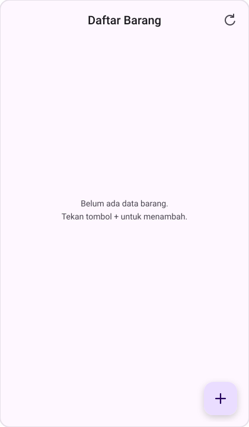
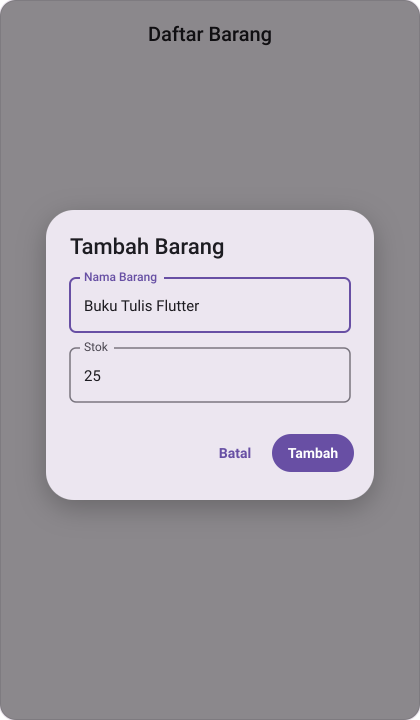
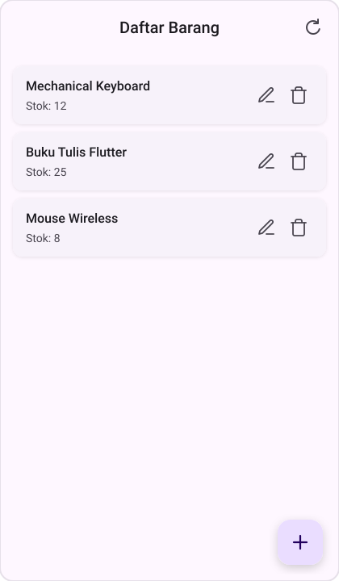
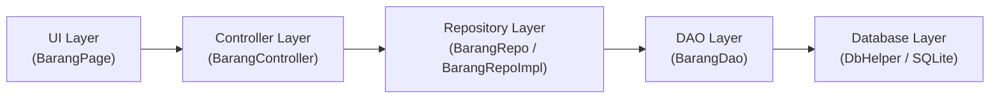

# Learn Storage — Belajar Local Storage Flutter (SQLite + GetX)

Project ini dibuat sebagai media pembelajaran **Local Storage (Penyimpanan Data Lokal)** di Flutter menggunakan **SQLite (`sqflite`)** dengan pola arsitektur berlapis (**Model → Database Helper → DAO → Repository → Controller → UI**) dan **GetX** untuk *State Management* serta *Dependency Injection*.

---

## Tampilan Aplikasi (Screenshots)

| Tampilan Awal (Kosong) | Form Tambah Barang | Daftar Barang (CRUD) |
| :---: | :---: | :---: |
|  |  |  |

---

## Apa yang Dipelajari di Project Ini?

1. **Penyimpanan Lokal Relasional dengan SQLite (`sqflite`)**
   - Membuat database lokal (`Barang.db`) dan mendefinisikan skema tabel SQL (`CREATE TABLE`).
   - Menjalankan operasi **CRUD (Create, Read, Update, Delete)** ke database SQLite.
   - Mendukung lintas platform: **Android, iOS, macOS** (`sqflite`), **Web / Chrome** (`sqflite_common_ffi_web` via WebAssembly + IndexedDB), dan **Windows / Linux** (`sqflite_common_ffi`).

2. **Layered Architecture (Pemisahan Tanggung Jawab Kode)**
   - Memisahkan kode menjadi layer yang rapi agar mudah dipahami, dirawat, dan diuji (*testable*).

3. **Dependency Injection & Reactive State Management (GetX)**
   - Menggunakan `Bindings` dan `Get.lazyPut` untuk menyuntikkan (*inject*) dependency antar-layer secara berurutan.
   - Menggunakan `GetxController`, variabel reaktif (`.obs`), dan `Obx` agar UI otomatis diperbarui setiap kali data di database berubah.

4. **Widget Testing dengan Fake Repository**
   - Menguji alur CRUD pada UI tanpa bergantung pada SQLite native menggunakan `FakeBarangRepo` yang mengimplementasikan interface `BarangRepo`.

---

## Arsitektur & Alur Data



### Struktur Folder

```text
lib/
├── main.dart                        # Entry point aplikasi (GetMaterialApp)
├── app_binding.dart                 # Dependency Injection (GetX Bindings)
├── model/
│   └── barang.dart                  # Data Model Barang (id, nama, stok)
├── data/
│   ├── database/
│   │   └── db_helper.dart           # Konfigurasi & koneksi database SQLite
│   ├── dao/
│   │   └── barang_dao.dart          # Data Access Object (Query SQL CRUD)
│   └── repo/
│       └── barang_repo.dart         # Abstraksi Repository & Implementasinya
├── controller/
│   └── barang_controller.dart       # State Management & Business Logic (GetX)
└── ui/
    └── barang_page.dart             # Tampilan Daftar Barang & Dialog Form CRUD
```

---

## Penjelasan Per Layer

### 1. Model (`lib/model/barang.dart`)
Merepresentasikan entitas `Barang` dengan atribut `id`, `nama`, dan `stok`.
- **`toMap()`**: Mengubah objek `Barang` menjadi `Map<String, dynamic>` agar bisa disimpan ke baris tabel SQLite.
- **`Barang.fromMap()`**: Mengubah hasil query SQLite (`Map<String, dynamic>`) kembali menjadi objek `Barang`.
- **`copyWith()`**: Memudahkan pembuatan salinan objek `Barang` baru saat melakukan *update* data tanpa mengubah objek aslinya (*immutability*).

### 2. Database Helper (`lib/data/database/db_helper.dart`)
Bertugas membuka koneksi database `Barang.db` dan membuat tabel `barang` saat pertama kali aplikasi dijalankan (`onCreate`):
```sql
CREATE TABLE barang (
  id INTEGER PRIMARY KEY AUTOINCREMENT,
  nama TEXT NOT NULL,
  stok INTEGER NOT NULL
)
```
- Menggunakan **Lazy Singleton database instance** (`_db ??= await _open()`) supaya koneksi database tidak dibuka berulang-ulang.
- Menyesuaikan `databaseFactory` secara otomatis berdasarkan platform (`databaseFactoryFfiWeb` untuk Web, `databaseFactoryFfi` untuk Windows/Linux, dan default `sqflite` untuk Android/iOS/macOS).

### 3. Data Access Object / DAO (`lib/data/dao/barang_dao.dart`)
Berisi fungsi-fungsi yang berinteraksi langsung dengan objek `Database` dari `DbHelper`:
- `insert(Barang barang)` → `db.insert(...)`
- `getAllBarang()` → `db.query(..., orderBy: 'id DESC')`
- `update(Barang barang)` → `db.update(..., where: 'id = ?', whereArgs: [barang.id])`
- `delete(int id)` → `db.delete(..., where: 'id = ?', whereArgs: [id])`

### 4. Repository (`lib/data/repo/barang_repo.dart`)
Terdiri dari *abstract class* `BarangRepo` dan implementasinya `BarangRepoImpl`.
- **Mengapa perlu Repository jika sudah ada DAO?**
  Controller hanya perlu tahu kontrak `BarangRepo` tanpa peduli dari mana data berasal (apakah dari SQLite, API, atau penyimpanan memori). Hal ini juga memungkinkan pembuatan `FakeBarangRepo` saat menulis pengujian di `test/widget_test.dart`.

### 5. Binding & Controller (`lib/app_binding.dart` & `lib/controller/barang_controller.dart`)
- **`AppBinding`**: Mendaftarkan seluruh dependency ke memori GetX secara *lazy* (baru dibuat saat dibutuhkan):
  `DbHelper` → `BarangDao` → `BarangRepo` → `BarangController`.
- **`BarangController`**:
  - Menyimpan state reaktif `barangList`, `isLoading`, dan `errorMessage`.
  - Memanggil `loadBarang()` saat `onInit()` dan setiap kali operasi tambah/ubah/hapus selesai agar daftar barang di layar selalu sinkron dengan isi database SQLite.

### 6. UI (`lib/ui/barang_page.dart`)
- Menggunakan `GetView<BarangController>` dan widget `Obx(...)` untuk menampilkan:
  - Indikator loading (`CircularProgressIndicator`) saat memuat data awal.
  - Pesan kosong (*empty state*) jika belum ada data barang.
  - Daftar barang (`ListView.separated` & `Card`) lengkap dengan tombol **Edit** dan **Hapus**.
- Menggunakan `_BarangFormDialog` (`StatefulWidget`) dengan validasi `Form` & `TextFormField` untuk menambah atau mengubah nama barang serta jumlah stok.

---

## Catatan Pembelajaran & Troubleshooting Penting

Selama pengerjaan project ini, ada beberapa pelajaran penting yang sering ditemui saat belajar Flutter Storage:

1. **Error `Bad state: databaseFactory not initialized` di Flutter Web / Desktop**
   - *Penyebab*: Package `sqflite` bawaan hanya berjalan secara native di Android, iOS, dan macOS.
   - *Solusi*: Menambahkan `sqflite_common_ffi_web` (beserta file `web/sqlite3.wasm` dan `web/sqflite_sw.js`) untuk Web dan `sqflite_common_ffi` untuk Desktop, lalu menginisialisasi `databaseFactory` di `DbHelper._open()`.

2. **Error `Assertion failed: _dependents.isEmpty is not true` saat Menutup Dialog Form**
   - *Penyebab*: Memanggil `TextEditingController.dispose()` tepat setelah `await showDialog(...)` membuat controller ter-dispose ketika animasi penutupan dialog masih berjalan dan `TextFormField` masih menempel di widget tree.
   - *Solusi*: Membungkus dialog form di dalam `StatefulWidget` (`_BarangFormDialog`) dan memanggil `dispose()` di dalam `_BarangFormDialogState.dispose()` sehingga controller baru dibersihkan setelah dialog benar-benar di-*unmount*.

---

## Cara Menjalankan Project

1. **Install dependencies**
   ```bash
   flutter pub get
   ```
2. **Jalankan aplikasi (Android / iOS / macOS / Chrome Web)**
   ```bash
   flutter run
   ```
3. **Analisis kode**
   ```bash
   dart analyze
   ```
